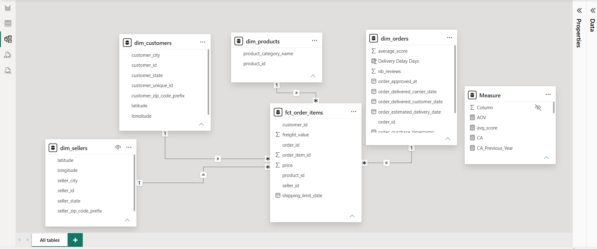
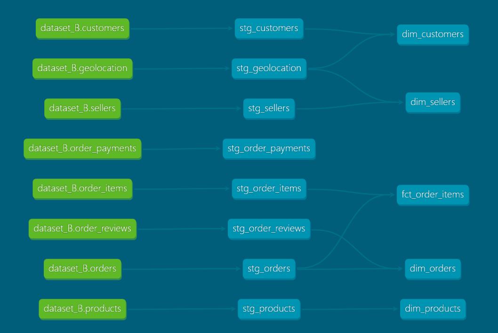
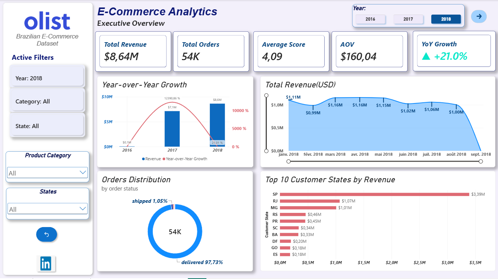
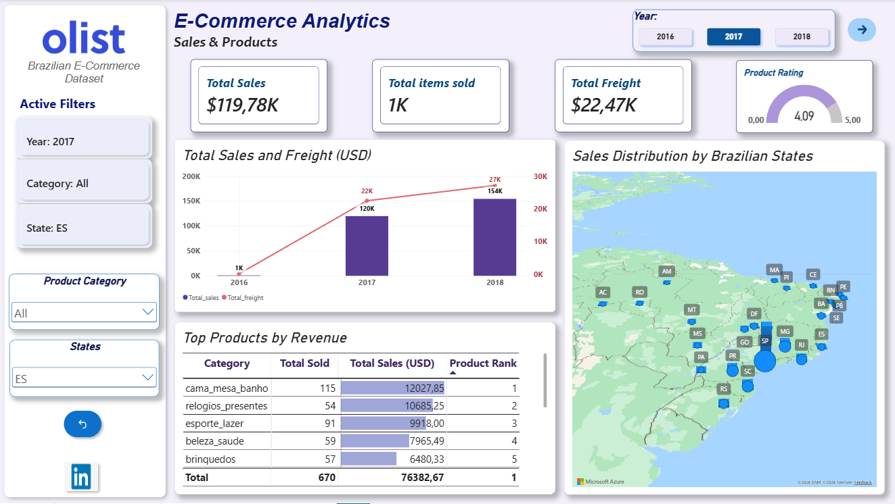
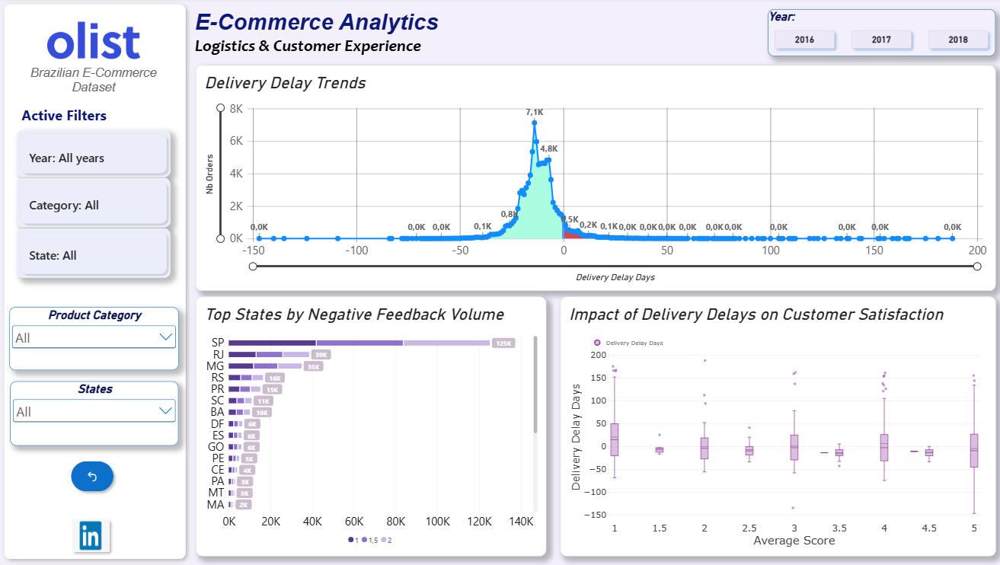

# E-Commerce Analytics Engineering

An end-to-end analytics engineering project built with **Python, Google BigQuery, dbt Core, SQL, and Power BI**, using the public [Brazilian Olist e-commerce dataset](https://www.kaggle.com/datasets/olistbr/brazilian-ecommerce?).

The project transforms raw transactional data into tested, analytics-ready models using an ELT architecture and a dimensional model designed for business intelligence.

## Project Overview

The objective of this project is to build a reproducible analytics engineering workflow that transforms raw e-commerce data into a structured analytical model for reporting and decision-making.
The source data represents historical Brazilian e-commerce transactions, primarily covering 2016–2018 , ingested as a batch snapshot into **Google BigQuery** using the BigQuery Python client library.


## Architecture

The project follows an **ELT (Extract, Load, Transform)** architecture.

1. **Extract and load:** Python scripts read the source CSV files and load the raw datasets into Google BigQuery.
2. **Transform:** dbt Core uses SQL models to clean, standardize, and transform the raw tables into staging models and analytical marts.
3. **Test and document:** dbt tests validate data quality and relationships, while dbt documentation exposes the models and their lineage.
4. **Visualize:** Power BI consumes the resulting analytical tables to create interactive dashboards that provide descriptive and diagnostic insights.


```text
Public Olist CSV datasets
          |
          v
Python ingestion scripts
          |
          v
Google BigQuery
Raw source tables
          |
          v
        dbt Core
          |
          +-------------------+
          |                   |
          v                   v
   Staging models       Data quality tests
          |
          v
   Analytical models
   Dimensions & Facts
          |
          v
       Power BI
Interactive dashboards
```

## Technology Stack

| Technology       | Purpose                                                  |
| ---------------- | -------------------------------------------------------- |
| Python           | Data ingestion and preparation                           |
| Google BigQuery  | Cloud data warehouse                                     |
| SQL              | Data transformation and modeling                         |
| dbt Core         | Transformation orchestration, testing, and documentation |
| Power BI Desktop/service | Interactive dashboards and business analysis             |
| Git              | Version control and project documentation                |

## Dimensional Modeling Structure

### Staging layer

Staging models provide a consistent foundation for downstream transformations through column renaming, data type standardization, and lightweight cleaning.

* `stg_customers`
* `stg_orders`
* `stg_order_reviews`
* ...


### Analytical layer

* **Fact Table:**
  * `fct_order_items`: Grain at the order line-item level, capturing individual product sales, prices, and freight charges.
* **Dimension Tables:**
  * `dim_customers`: Customer attributes and geographic information.
  * `dim_products`: Product categories, descriptions, and physical characteristics.
  * `dim_sellers`: Seller attributes and locations.
  * `dim_orders`: Order dates, status, and order-level review metrics.
                  

### Star schema

The dimensional model supports analytical queries by separating descriptive attributes from transactional measures.



*Figure 1 — Star schema of the analytical data model.*


## Data Lineage

dbt generates a lineage graph showing the dependencies between source tables, staging models, and analytical models.



*Figure 2 — dbt model lineage from raw BigQuery sources to analytical models.*

## Data Quality and Testing

Data quality is validated using dbt's built-in tests.

Depending on the model and its configuration, tests can include:

* **`not_null`:** verifies that required fields do not contain null values.
* **`unique`:** checks uniqueness for identifiers that should be unique at the model's declared grain.
* **`relationships`:** validates referential integrity between related models.
* **`accepted_values`:** checks that categorical fields contain permitted values.

## Power BI Reports

### 1. Executive Summary

Provides a high-level overview of e-commerce performance using KPIs and summary visuals.

### 2. Sales and Products Analysis

Explores sales performance, revenue distribution, product performance, and seller geography.

### 3. Logistics and Delivery Performance

Examines delivery delays by comparing estimated and actual delivery dates, and explores their association with customer review scores.

The analysis is descriptive and diagnostic. Observed relationships between delivery delays and review scores should not be interpreted as proof of causation.
> **Power BI Report File:** download the complete `.pbix` file [here](./reports/olist_ecommerce_report.pbix) to explore the data model, relationships, and DAX measures locally.


## Local Setup

### Prerequisites

* Python and a virtual environment for the ingestion scripts.
* Google Cloud CLI (`gcloud`).
* Access to a Google Cloud project with BigQuery enabled and the necessary permissions.
* dbt Core.
* Power BI Desktop to explore the reports.


```powershell
# Clone the repository
git clone https://github.com/AmalAkiirne/analytics-engineering.git
cd B-elt

# Authenticate with Google Cloud using Application Default Credentials (ADC):
gcloud auth application-default login

# Select the Google Cloud project
gcloud config set project PROJECT_ID

#  Install dbt Core and the BigQuery adapter
python -m venv .venv
.\.venv\Scripts\Activate

python -m pip install dbt-core dbt-bigquery

# Install project dependencies
dbt deps
```


### Run the transformations

```powershell
# Build the configured models
dbt run

# Execute the configured data tests
dbt test

# Generate and serve documentation
dbt docs generate
dbt docs serve
```

The documentation includes model descriptions, columns, tests, dependencies, and the lineage graph, depending on the metadata defined in the project.


### BigQuery tables created

```sql
SELECT
    table_name,
    table_type
FROM
    `PROJECT_ID.TARGET_DATASET.INFORMATION_SCHEMA.TABLES`
```

| Object              | Type                  |
| ------------------- | --------------------- |
| `stg_customers`     | VIEW                  |
| `stg_orders`        | VIEW                  |
| `stg_order_reviews` | VIEW                  |
| `stg_geolocation`   | VIEW                  |
| `stg_order_items`   | VIEW                  |
| `stg_order_payments`| VIEW                  |
| `stg_products`      | VIEW                  |
| `stg_sellers`       | VIEW                  |
| `dim_customers`     | BASE TABLE            |
| `dim_sellers`       | BASE TABLE            |
| `dim_products`      | BASE TABLE            |
| `dim_orders`        | BASE TABLE            |
| `fct_order_items`   | BASE TABLE            |


---
